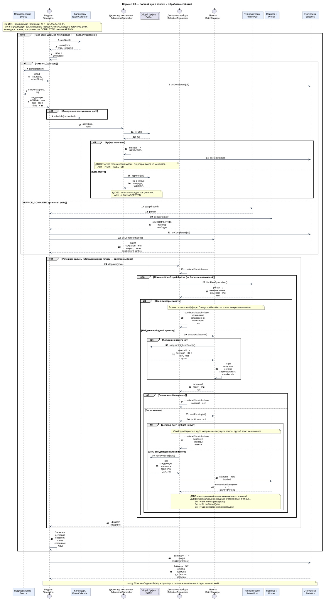
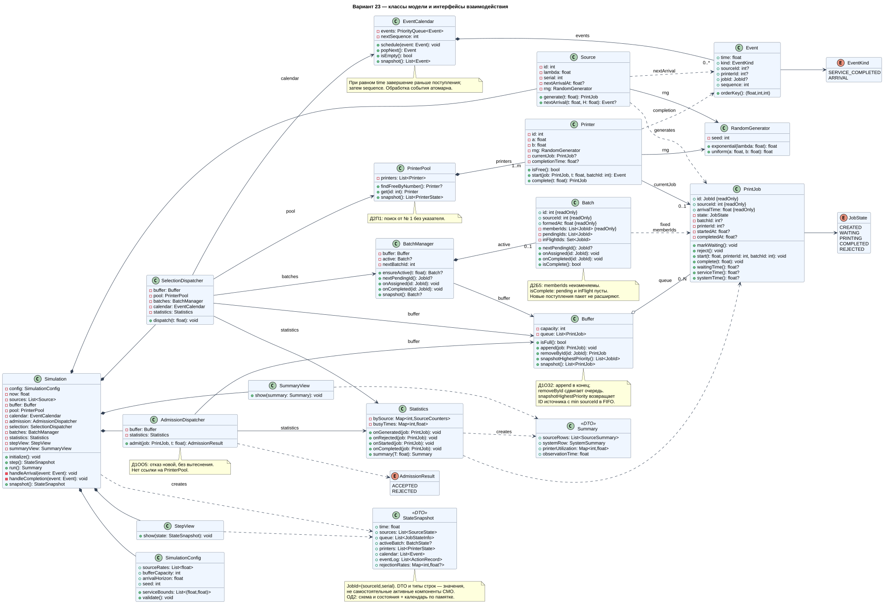
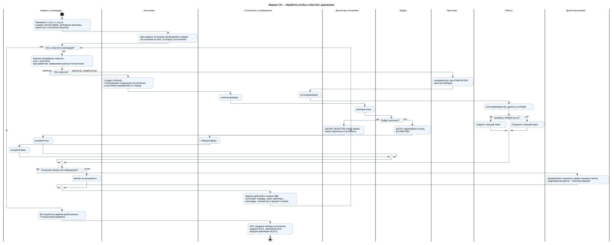
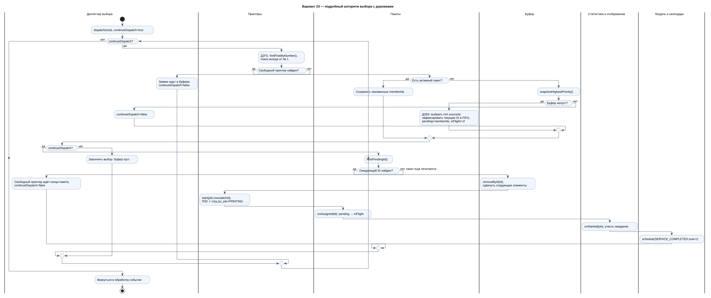
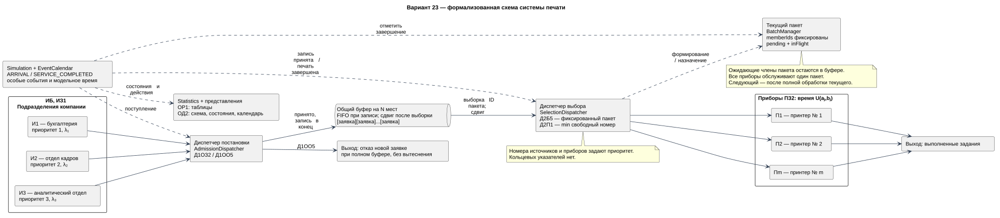

# Система централизованной печати документов — вариант 23

**Ковальчук Егор Олегович · группа 5130904/40102**

Первичные артефакты курсовой работы по имитационному моделированию СМО.
Подразделения компании отправляют задания в общую ограниченную очередь сервера печати.
Сетевые принтеры выполняют задания фиксированными пакетами одного подразделения.
Репозиторий содержит проект модели: диаграммы, правила и сценарии для защиты.

## Формула варианта

`ИБ | ИЗ1 | ПЗ2 | Д1ОЗ2 | Д1ОО5 | Д2П1 | Д2Б5 | ОР1 | ОД2`

| Код | Правило в модели |
| --- | --- |
| ИБ | Бесконечные источники: подразделения продолжают генерировать заявки независимо от их обслуживания |
| ИЗ1 | Пуассоновский поток каждого источника; независимые интервалы поступления Exp(λᵢ) |
| ПЗ2 | Время печати U(aⱼ, bⱼ), 0 < aⱼ < bⱼ |
| Д1ОЗ2 | Запись в конец общей очереди; после извлечения последующие элементы сдвигаются |
| Д1ОО5 | При полном буфере отказ получает новая заявка; ранее принятые не вытесняются |
| Д2П1 | Каждый поиск свободного принтера начинается с № 1; выбирается минимальный свободный номер |
| Д2Б5 | Выбирается минимальный номер источника среди ожидающих; фиксируется пакет его текущих заявок |
| ОР1 | Автоматический режим: сводные таблицы статистики |
| ОД2 | Пошаговый режим: формализованная схема и состояния компонентов; календарь событий по памятке |

Номер источника задаёт приоритет: **1 — бухгалтерия, 2 — отдел кадров, 3 — аналитический отдел**.
Кольцевых указателей в варианте 23 нет. Порядок внутри пакета — FIFO.

## Бизнес-домен и маппинг

| Элемент СМО | Элемент системы печати |
| --- | --- |
| Источник | Подразделение компании |
| Заявка | Задание на печать комплекта документов |
| Буфер | Общая очередь сервера печати на N заданий |
| Прибор | Сетевой принтер, выполняющий одно задание без прерывания |
| Диспетчер постановки | Приём задания, запись в очередь или отказ |
| Диспетчер выбора | Формирование пакета и назначение его заданий свободным принтерам |
| Обслуживание | Печать комплекта документов |
| Выход | Завершённое либо отклонённое задание |

Подробно: [бизнес-домен](docs/business-domain.md), [маппинг](docs/mapping.md).
Оригинальные авторские документы: [бизнес-домен DOCX](docs/source/business-domain.docx), [маппинг DOCX](docs/source/mapping.docx).

## Правила, общие для всех диаграмм

Диспетчер постановки всегда сначала работает с буфером. После успешной записи модель вызывает
диспетчер выбора; второй триггер выбора — завершение печати. При свободном буфере и принтере
заявка записывается и сразу извлекается в тот же момент модельного времени, без ожидания.

Пакет содержит **фиксированный набор ID** заявок одного источника, находящихся в буфере
при его формировании. Ожидающие заявки пакета занимают места в буфере до назначения.
Новые задания пакет не расширяют. Все принтеры обслуживают только текущий пакет.
Следующий пакет формируется после завершения всех заданий текущего, включая уже печатаемые.
Если ожидающих заданий пакета больше нет, а печать ещё идёт, свободные принтеры простаивают.

Эта трактовка соответствует предоставленным бизнес-домену, маппингу и уточнению в памятке.
Полные алгоритмы, формулы и принятые решения: [правила модели](docs/model-rules.md).

## Первичные артефакты

### 1. Общая диаграмма последовательности

Генерация, успешное размещение, переполнение, занятость принтеров, выбор из пакета,
назначение и завершение печати. Алгоритм повторных назначений раскрыт в диаграмме пакетов.

[PlantUML](docs/diagrams/sequence-main.puml) · [PNG](docs/diagrams/sequence-main.png)

### 2. Диаграмма классов

Поля, методы, приватные ссылки диспетчеров на компоненты и типизированные связи.

[PlantUML](docs/diagrams/classes.puml) · [PNG](docs/diagrams/classes.png)

### 3. Блок-схема с дорожками

Общая схема обработки событий и подробная схема выбора вместе показывают все альтернативы:
полный буфер, отсутствие свободных принтеров, пустой буфер, активный пакет без ожидающих
заданий, формирование и завершение пакета.

[PlantUML](docs/diagrams/flowchart.puml) · [PNG](docs/diagrams/flowchart.png)

[PlantUML алгоритма выбора](docs/diagrams/flowchart-dispatch.puml) · [PNG](docs/diagrams/flowchart-dispatch.png)

### 4. Отдельные сценарии последовательности

| Сценарий | Изображение | Исходник |
| --- | --- | --- |
| Happy Flow: буфер и принтер свободны | [SVG](docs/diagrams/sequence-happy.svg) / [PNG](docs/diagrams/sequence-happy.png) | [PlantUML](docs/diagrams/sequence-happy.puml) |
| Отказ новой заявке при переполнении | [SVG](docs/diagrams/sequence-overflow.svg) / [PNG](docs/diagrams/sequence-overflow.png) | [PlantUML](docs/diagrams/sequence-overflow.puml) |
| Выбор пакета, выборка, назначение и ожидание | [SVG](docs/diagrams/sequence-batch.svg) / [PNG](docs/diagrams/sequence-batch.png) | [PlantUML](docs/diagrams/sequence-batch.puml) |

### 5. Формализованная схема СМО

[PlantUML](docs/diagrams/formal-scheme.puml) · [PNG](docs/diagrams/formal-scheme.png)

## Материалы для защиты и проверки

- [Сценарии, пример состояний и инварианты](docs/scenarios.md).
- [Соответствие требованиям первичных артефактов](docs/requirements.md).
- [Навигация по диаграммам](docs/diagrams/README.md).
- [Проверка и повторный рендеринг](tools/README.md).

Готовые SVG и PNG включены в репозиторий. Все `.puml` самостоятельны и сохранены в UTF-8.
Для локальной проверки без сети: `java -jar plantuml.jar -checkonly docs/diagrams/*.puml`.
Для повторного получения SVG и PNG: `python tools/render_diagrams.py` (требуется сеть).

## Границы этапа

Это этап проектирования до реализации программы. Эксперименты, экономическое обоснование,
оптимальная конфигурация и численные результаты появятся после реализации и запусков модели.
Здесь определены правила сбора статистики и отображения, но экспериментальные значения не заявляются.
Временная диаграмма и ArchiMate не включены: памятка не требует первую и делает вторую опциональной.

